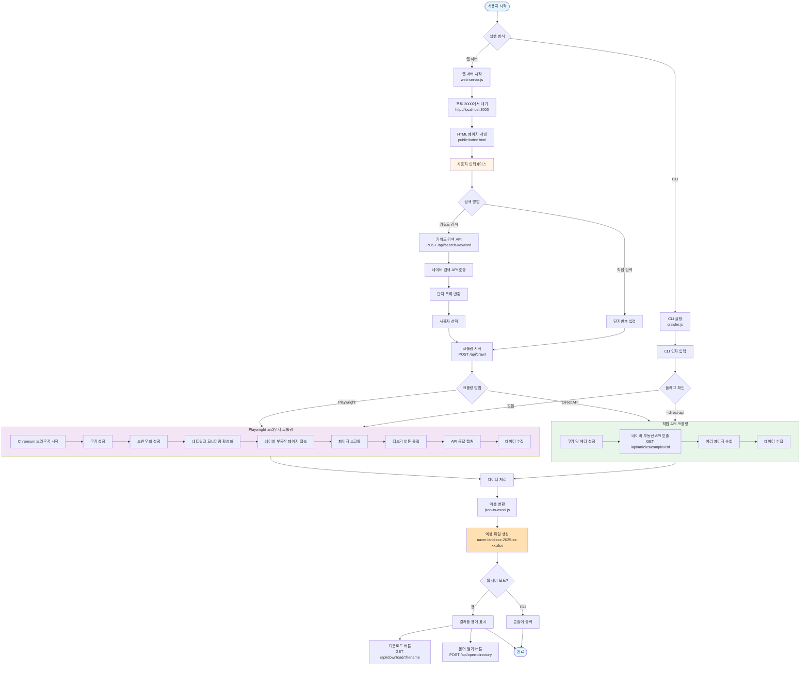
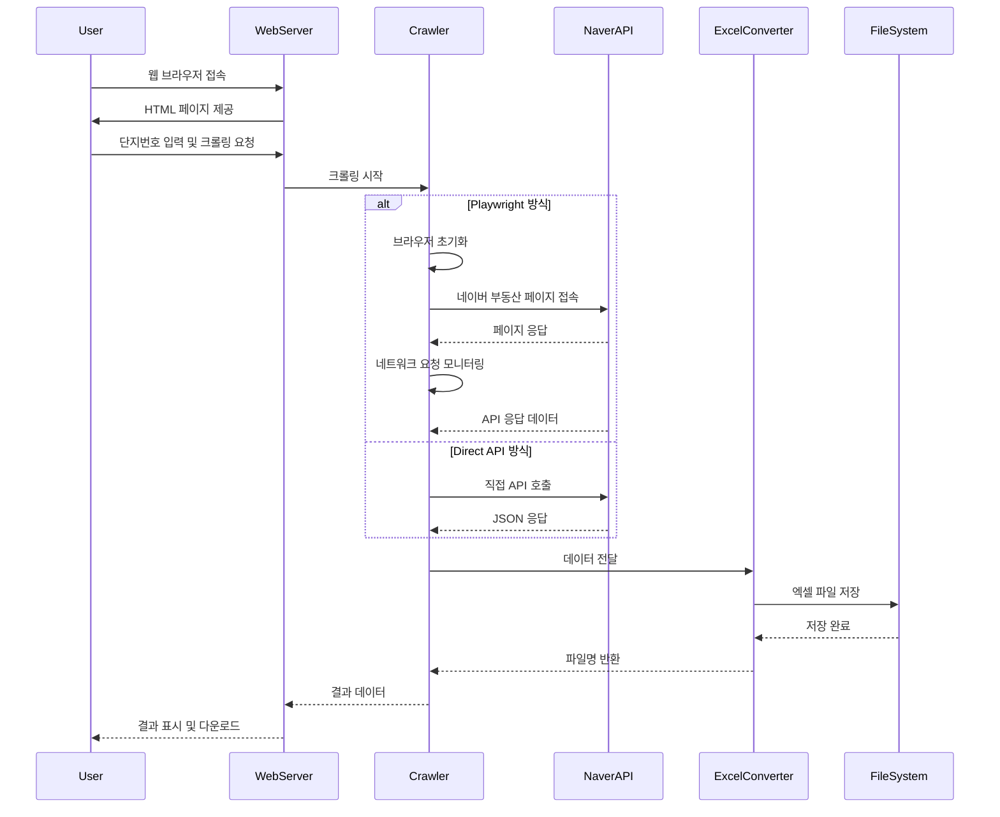
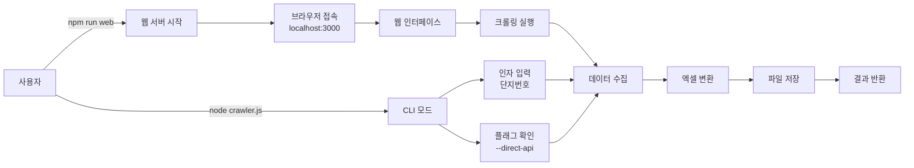

# 네이버 부동산 크롤러 프로젝트 Flow

## 전체 시스템 Flow



## 주요 컴포넌트 설명

### 1. 웹 서버 (web-server.js)
- Express 웹 서버로 3000 포트에서 실행
- RESTful API 제공
- 정적 파일 서빙 (HTML, CSS, JS)

### 2. 크롤러 종류
- **Playwright 크롤러 (crawler.js)**: 브라우저 자동화
- **API 크롤러 (direct-api-crawler.js)**: 직접 API 호출

### 3. 데이터 처리 흐름
- 네트워크 요청 모니터링 또는 직접 API 호출
- JSON 데이터 추출
- 엑셀로 변환 (XLSX 라이브러리)
- 파일 저장 또는 웹 다운로드

## API 엔드포인트

```
GET  /                          → HTML 페이지
POST /api/crawl                 → 크롤링 시작
GET  /api/download/:filename    → 파일 다운로드
GET  /api/files                 → 파일 목록 조회
POST /api/search-keyword        → 키워드 검색
POST /api/open-directory        → 폴더 열기
```

## 데이터 흐름



## 기술 스택

- **백엔드**: Node.js + Express
- **크롤링**: Playwright (브라우저 자동화) + Fetch API (직접 API)
- **데이터 처리**: XLSX (엑셀 파일 생성)
- **프론트엔드**: Vanilla JavaScript (public/index.html)

## 실행 흐름



